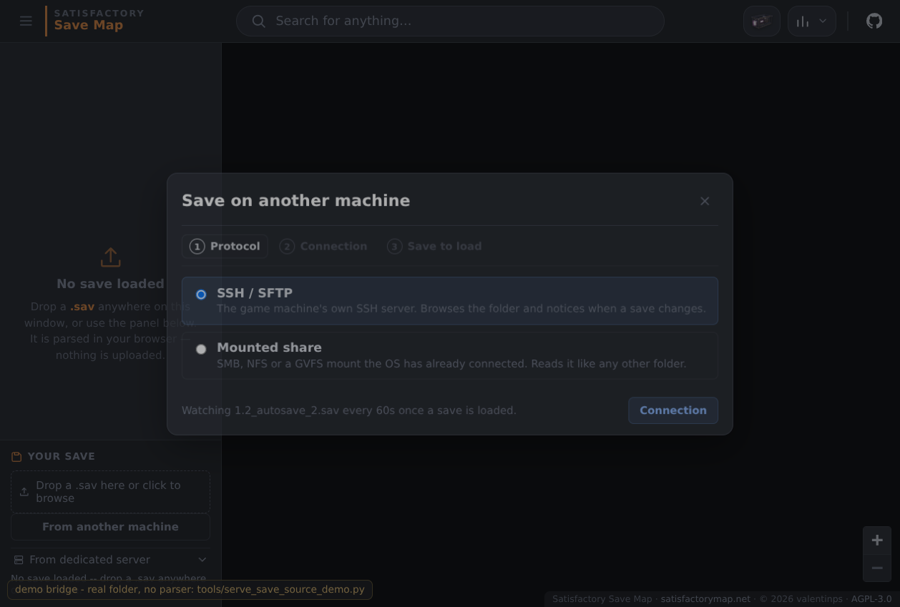

# Load the save off the machine that runs the game (desktop app)

The desktop app can load the `.sav` straight off the gaming PC and keep
reloading it as the game autosaves. It does that with what that machine already
has — **its OpenSSH server** — rather than by asking it to host the file:
nothing listens, no port is opened for the app, and the authentication is the
key and `~/.ssh/config` the user already has.

## The dialog: three steps, one decision each

**Your save → From another machine.**



1. **Protocol** — two choices, each explained in a line:
   | Protocol | Needs on the game machine | Gives |
   |---|---|---|
   | **SSH / SFTP** | OpenSSH server (built into Windows 10/11 and every Linux) | folder browsing, a cheap change check, rsync when it is installed |
   | **Mounted share** | SMB/NFS/GVFS share mounted by the OS | the same browsing and change check, no protocol code at all |
2. **Connection** — the answers that protocol needs, then *Validate connection*:
   it reports the login, whether the SFTP subsystem answers (browsing and the
   change check depend on it), and whether the far side has rsync. A failure
   shows the ssh client's own words and the one thing to try next — a refused
   key, an unknown host key, a port nothing answers on, a machine whose own
   `ssh` is broken, a server with no SFTP subsystem.
3. **Save to load** — the folder, walked like a file dialog (folders first,
   `.sav` marked, `Up` for the parent), then the file. *Newest `.sav`* follows
   the autosave rotation; *Keep it fresh* reloads the map when the save
   changes -- see below for what "when" means.

The stepper's numbers go back to a step already reached, and a remembered
source reopens straight at the file it was left on.

## Setting up the game machine (Windows)

Run these in an **elevated PowerShell**. The save folder comes with the server
capability; nothing else is installed.

```powershell
Add-WindowsCapability -Online -Name OpenSSH.Server~~~~0.0.1.0
Set-Service -Name sshd -StartupType Automatic
Start-Service sshd
New-NetFirewallRule -Name sshd -DisplayName 'OpenSSH Server (sshd)' -Enabled True `
  -Direction Inbound -Protocol TCP -Action Allow -LocalPort 22
```

Then, as the account that owns the saves (add your own public key):

```powershell
mkdir -Force $env:USERPROFILE\.ssh | Out-Null
Add-Content $env:USERPROFILE\.ssh\authorized_keys 'ssh-ed25519 AAAA... you@laptop'
icacls $env:USERPROFILE\.ssh\authorized_keys /inheritance:r /grant "$($env:USERNAME):R"
```

The saves are at
`C:\Users\<you>\AppData\Local\FactoryGame\Saved\SaveGames\<steamid64>\`, which
is why the dialog opens on the SFTP form of that path: `/C:/Users/...`. On
Linux the game writes into the Proton prefix — the dialog's suggested path is
the usual one.

An admin password is never asked for and never stored: the dialog sets
`BatchMode=yes`, so authentication is key/agent only by design. A host whose
key is not in `known_hosts` is refused until **Trust this host's key the first
time** is ticked, which adds it once (trust on first use, the same disclosure as
the dedicated-server certificate pin). A *changed* key is still refused.

## While it is watching

**Changes are pushed when the machine can push them, and checked on an interval
when it cannot.** `inotifywait` is run *on the machine that holds the folder* —
locally, or over the ssh connection — and every name it prints wakes the same
check; on Windows the equivalent is PowerShell's `FileSystemWatcher`, sent as a
base64 `-EncodedCommand` so nothing in the path can be reinterpreted by
`cmd.exe`. Nothing is polled while events are live.

Two cases fall back to the interval, and the dialog says which one you got:

- **No `inotifywait` on that machine** (Debian/Ubuntu: `apt install
  inotify-tools`; Fedora: `dnf install inotify-tools`; Bluefin:
  `rpm-ostree install inotify-tools`). Windows needs nothing — the watcher is
  part of .NET.
- **A mounted share on Linux.** `inotify` only reports writes made through this
  machine's own kernel, so the game machine writing into an SMB or NFS share is
  invisible to it — the watch would be silent rather than late, which is worse.
  The filesystem type is checked before choosing, so this is decided rather than
  hoped. Windows is the exception: `FileSystemWatcher` does receive SMB
  notifications, so a UNC path or a mapped drive there still gets events.

An event is a nudge, not a verdict: the burst a save write produces is
debounced, then the folder is re-listed and the fetched bytes are hashed, so a
missed or spurious event cannot reload the map wrongly.

The status line says what each check saw. Reloading is refused while the editor
holds pending edits (a reload discards them), while a parse is already running,
and while the window is hidden — it resumes on its own. Remote names are
rendered as text, never as markup.

A fetched save lands in the app's data directory under `remote-saves/`, written
to a `.part` file and renamed only when complete, and capped at 8 GiB, so a
wrong path cannot fill the disk and a truncated transfer cannot become the file
the parser reads.

## Running it locally

**The dialog, without building anything** (needs only Python):

```sh
python3 tools/serve_save_source_demo.py --dir /path/to/SaveGames
# then open http://127.0.0.1:8793/ and click Your save -> From another machine
```

That serves `map/static/map/` with a stubbed desktop bridge: the three commands
answer from a real folder, so the listing, its sizes and timestamps, the
"newest .sav" pick and the watch's change check are real (drop a file in the
folder and the next tick notices). Only the SSH transport is canned, and loading
stops at the parser -- `sav_core` is in the desktop build and `dist/pkg` is the
wasm build, neither of which that server has -- so the status line says so
rather than pretending.

**The real thing on Linux** (the app itself, real SSH, real parsing). The Tauri
tree needs the WebKitGTK/GTK development packages, which an immutable distro
does not carry, so build it in a container:

```sh
distrobox create --name satisfactory-map --image registry.fedoraproject.org/fedora:41
distrobox enter satisfactory-map
sudo dnf install -y webkit2gtk4.1-devel gtk3-devel libsoup3-devel librsvg2-devel \
  openssl-devel cairo-devel pango-devel gdk-pixbuf2-devel
curl --proto '=https' --tlsv1.2 -sSf https://sh.rustup.rs | sh
cd <checkout>/rust_parser && cargo build -p sav_tauri --release
cargo tauri dev            # or: cargo tauri build
```

**The real thing on Windows** is the repo's normal build (`cargo tauri build`)
plus the sshd setup above -- and Windows is where the game machine is, so this
is the path that ends in a working map.

### If SSH is already broken on the machine running the app

The dialog reports the ssh client's own words, and one of them is worth knowing
about: on an ostree/Bluefin-style install, files under `/etc/ssh/ssh_config.d/`
can end up owned by an unmapped uid (`nfsnobody`). OpenSSH treats a non-root
owned included config as fatal, so **every** `ssh` invocation fails with:

```
Bad owner or permissions on /etc/ssh/ssh_config.d/20-systemd-ssh-proxy.conf
```

That is not this app's bug and it breaks `ssh` in a terminal too; fix the
ownership (`sudo chown root:root /etc/ssh/ssh_config.d/*`) and Validate
connection starts answering.

## Implementation notes

- `map/static/map/save_source.js` — the dialog, the browser and the watch loop.
- `rust_parser/tauri/src/ssh_source.rs` — runs `ssh`, `sftp` and `rsync` as
  subprocesses with a deadline, parses their output, and hashes what arrives.
  The app ships no SSH stack: host keys, keys, agents and `ProxyJump` are
  OpenSSH's, so the app never grows a second implementation of any of it.
- Commands: `source_validate`, `source_browse`, `source_fetch` for the three
  jobs the dialog has, plus `source_watch_start` / `source_watch_stop` for the
  event watcher (a long-lived child process, local or over ssh, kept in the
  Tauri state because a webview cannot hold one). The watch probe is a `source_browse`, because a listing
  is what says both what is in the folder and whether it moved. Every remote
  path crosses into an SFTP batch script, so control characters and quotes are
  rejected at the boundary; a host, user or port that could be read as an
  option is rejected too.
